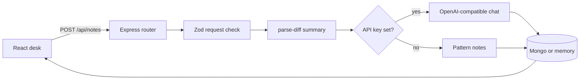

# Developer notes

This file is the map of the code. Read it before changing a route or the prompt. The product explanation for someone running the app is in [README.md](README.md).

## Shape

Two packages, one repo, npm workspaces.

```text
client/     React + Vite + Tailwind. Talks only to /api.
server/     Express. Owns validation, parse-diff, the model, and storage.
```

The client does not import server files. The note contract is duplicated in `client/src/types.ts` and `server/src/types.ts` on purpose. A shared package would be a third workspace for one interface. If you add a field, change both types and the Zod schema that actually enforces the model output.



## Request path

1. `client/src/App.tsx` submits the form through `client/src/api.ts` (axios).
2. `server/src/routes/notes.ts` parses the body with `noteRequestSchema`. A failed parse is a 400 with one sentence, not the raw Zod tree.
3. `reviewDiff` in `server/src/ai/review.ts` builds a short summary with `parse-diff`, then either calls the model or `heuristicNote`. The original diff text is still sent to the model.
4. The store inserts the input plus the result. The response is the saved record, including its id, so the UI can select it without a second fetch.
5. Errors from the store or an unexpected throw hit the handler in `server/src/app.ts` and become a 500 `{ error }`.

`GET /api/health` is how the header knows whether it is showing a model name or the words "offline notes". The handler does not return the API key.

## Model contract

`modelResultSchema` is the only shape we accept from a model:

- `summary` string
- `comments` array of `{ file, tag, comment, line? }` where `tag` is `bug | risk | question | nit`

`source` and `model` are set by our code after parsing. The model is not allowed to claim it is the offline checker, and the offline checker is not allowed to claim it is a model.

Flow inside `fromModel`:

1. Ask with `response_format: json_object`.
2. If that flag is rejected by the provider, retry the same prompt without it.
3. Strip optional markdown fences in `extractJson` and run Zod.
4. On invalid JSON, ask once more, quoting a clipped reason.
5. If that still fails, or the HTTP call fails, return the heuristic result and put the failure in `summary`. The user still gets a saved note, and the badge still says the result is offline.

The system prompt's important rule: comment only on what is present in the diff. Do not invent file names or line numbers. That is the behavior you should be able to defend in an interview. The code does not have a second checker that proves the model obeyed. Zod checks shape, not truth.

Temperature is `0.2` so repeated runs on the same diff stay closer.

## Offline checker

`heuristicNote` is not a miniature model. It does three things:

- Runs `parseDiff` so it knows the real file names and hunk counts.
- Scans added lines for a few patterns (plain password equality, TODO/FIXME, console.log/debugger, large additions).
- Emits one comment per file, tagged accordingly, or a single question if the paste is not a recognizable diff.

It never invents a file that `parse-diff` did not see.

## Storage

`NoteStore` in `server/src/types.ts` is the seam: `insert`, `list`, `get`, `remove`.

- `createMemoryStore` keeps an array in the process. Newest first. Used when `MONGO_URI` is empty so `npm run dev` works with zero infrastructure. Data dies with the process. Say that out loud if you demo it.
- `createMongoStore` connects with Mongoose and maps `_id` to `id` at the edge. Callers never see an ObjectId. Invalid ids return null instead of throwing, so a bad id is a 404.

`connectStore` is the only place that chooses. Routes take a `NoteStore`, which is why `memory.test.ts` does not need a database.

Documents are not user-scoped. There is no account system. Do not store real private diffs on a shared server until that exists.

## UI

`App` holds the form, the selected note, and the history list. Server state lives in TanStack Query (`queryKey: ["notes"]`). After a create or delete the mutation invalidates that key. There is no second copy of the list in `useState`.

The selected note is an id into the list, not a second copy, so a delete cannot leave a stale detail on screen.

`Load sample` fills the same fields a reviewer would paste. It does not skip the API. You can watch the network call.

Styles are Tailwind utilities. There is no hand-written CSS design system.

## Library notes

- **Tailwind CSS** (`@tailwindcss/vite`): all UI styling. Used throughout `client/src/App.tsx`. Interview question: how do you style a React app without a large CSS file or a component library?
- **date-fns**: every timestamp the user sees. `formatWhen` and `formatRelative` in `client/src/dates.ts` call `format` and `formatDistanceToNow`. Example: `format(parseISO("2026-11-07T10:00:00Z"), "PPp")` returns a localized date and time such as "Nov 7, 2026, 10:00 AM". Interviewers still say "moment"; the answer is: Moment is legacy, mutable, and heavy; this repo uses date-fns.
- **axios**: every API call. `client/src/api.ts` creates a client with `baseURL: "/api"` and uses `get`/`post`/`delete`. Interview question: how do you make HTTP requests from the browser without raw `fetch`?
- **TanStack Query**: loading, creating, and deleting server data. `useQuery({ queryKey: ["notes"], queryFn: fetchNotes })` and `useMutation` that calls `invalidateQueries`. Interview question: how do you keep server state out of a second `useState` copy?
- **Zod**: request bodies and model JSON. `noteRequestSchema` and `modelResultSchema` in `server/src/ai/schema.ts`. Interview question: how do you validate untrusted JSON before you trust it?
- **helmet**: basic Express security headers. `app.use(helmet())` in `server/src/app.ts`. Interview question: what is the first middleware you add for Express security headers?
- **parse-diff**: featured extra. Turns the unified diff into files and hunks in `summarizeDiff` (`server/src/ai/heuristic.ts`) before the model sees a summary. The original diff text is still sent. Interview question: how do you avoid sending a raw 10k-line diff to the model without losing the ability to quote real file names?

Redux Toolkit is for a large shared client cache this app does not have. Server state stays in React Query; the form is local `useState`.

## Tradeoffs

- In-memory fallback makes the repo runnable in a portfolio review. It is the wrong store for anything private or multi-instance.
- Falling back to the heuristic when the model fails keeps the demo alive. It can also hide a bad key. The summary string is the signal. The health badge is the other one.
- Duplicated types will drift if you only edit one side. The API response is the runtime contract. TypeScript will not catch a client that forgot a new field until you use it.
- `Mixed` for the Mongo result is deliberate. The result shape is owned by Zod at write time. A rigid Mongoose subschema would reject old rows the moment the JSON gained a key.
- `parse-diff` gives us real file names for the offline path and a short summary for the model. It does not understand language semantics.

## Interview walkthrough

If someone asks you to explain this repo, walk this path and stop where they interrupt:

1. The UI never calls a model. It only posts text to Express via axios.
2. Zod rejects short or huge payloads before any token is spent.
3. We run `parse-diff` so the model sees a file summary plus the original text.
4. The model must return JSON. We parse it, check it, and retry once.
5. We label heuristic results so a missing API key cannot look like GPT.
6. Mongo is optional behind a store interface. Tests hit the memory implementation.
7. There is no auth, so the README tells you not to deploy it with private diffs.

## What I would not add next without a reason

Login, a full code-review agent that rewrites the diff, or a multi-file workspace. Each one is a new product. The current gap that matters is the quality of the comments, not more screens.
